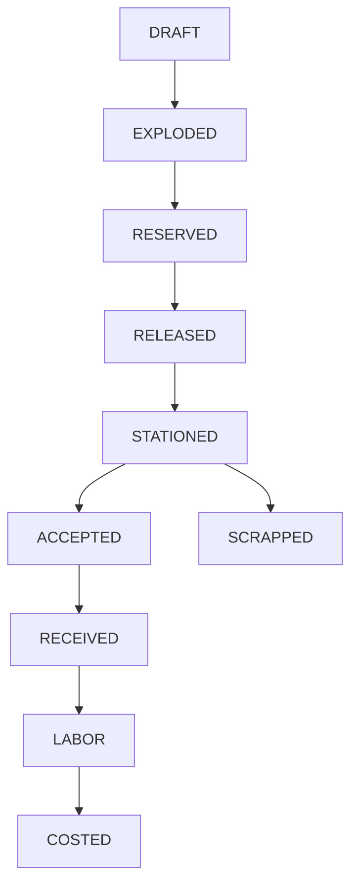
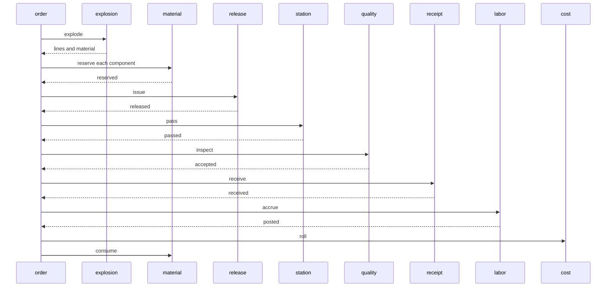

# Plant Order

A planner releases a work order for a finished good. Thirteen services each own one Postgres database. The order service is the saga orchestrator. It does not call the others over HTTP. A step commits its own row and an outbox message in one local transaction. A relay publishes that message. The next service claims an inbox key before it writes. If a later step fails, the orchestrator writes compensating commands for the steps that already committed. Returning a component is a new reservation release. It is not a rollback of the reserve.

The bill of materials is exploded in integers. Two of a parent that uses 4 bolts at 20 cents and 2 nuts at 30 cents reserves 8 bolts and 4 nuts. Material is 280 cents. Labor at 100 cents times the order quantity is 200 cents. The rollup is 480 cents.

On-hand decreases only when it still covers the quantity. The next component is reserved after the previous one is held. A short second component returns the first. A held lot returns every component and receives nothing. A scrapped lot keeps the components, receives nothing, and still rolls material and labor. A closed dock voids the inspection and the floor release and returns the components.



A station token whose text contains `broken` never passes the station. A lot whose text contains `scrap` is scrapped. A lot whose text contains `hold` is held. Scrap is decided before hold. A dock whose text contains `closed` never receives the finished good. An empty bill cancels before any reservation. A quantity that overflows the integer explosion cancels before any reservation.



The relay can publish a message and crash before it marks the row sent. The broker then holds a second copy. Consumers dedupe with the inbox key. The saga moves an order forward only from the status that step expects, so a repeated fact does not apply twice. There is no distributed transaction.

## Services

| Service | Owns | Port |
| --- | --- | --- |
| item-service | finished goods and components | http://localhost:8221 |
| bom-service | quantity per parent | http://localhost:8222 |
| order-service | the work order and the saga | http://localhost:8223 |
| explosion-service | the exploded lines and the material cents | http://localhost:8224 |
| material-service | on-hand and one reservation per component | http://localhost:8225 |
| release-service | the floor release | http://localhost:8226 |
| station-service | the station pass | http://localhost:8227 |
| quality-service | accept, hold, or scrap | http://localhost:8228 |
| scrap-service | the scrapped quantity | http://localhost:8229 |
| receipt-service | the finished goods | http://localhost:8230 |
| labor-service | the labor accrual | http://localhost:8231 |
| cost-service | material plus labor | http://localhost:8232 |
| audit-service | one row per fact | http://localhost:8233 |

Postgres is `localhost:5444`. Kafka's host listener is `localhost:9105`. RabbitMQ management is http://localhost:15684.

## Run

```bash
mvn -q -DskipTests package
docker compose up --build -d
./scripts/smoke.sh
docker compose down
```

```bash
curl -s -X POST localhost:8221/items \
  -H 'content-type: application/json' \
  -d '{"sku":"BOLT","kind":"COMPONENT","standardCents":20,"laborCents":0}'

curl -s -X POST localhost:8221/items \
  -H 'content-type: application/json' \
  -d '{"sku":"GEAR","kind":"FINISHED","standardCents":0,"laborCents":100}'

curl -s -X POST localhost:8222/boms \
  -H 'content-type: application/json' \
  -d '{"parentSku":"GEAR","componentSku":"BOLT","qtyPer":4}'

curl -s -X POST localhost:8225/stock \
  -H 'content-type: application/json' \
  -d '{"sku":"BOLT","onHand":20}'

curl -s -X POST localhost:8223/orders \
  -H 'content-type: application/json' \
  -d '{"requestId":"wo-1","itemSku":"GEAR","quantity":2,"stationToken":"STATION-1","lot":"LOT-A","dock":"DOCK-1"}'
```

The same `requestId` returns the original order and does not reserve a second time. Two gears use 8 bolts. Material is 160 cents when the nut line is absent, and 280 cents when the nut line from the example above is present. Labor is 200 cents. The posted cost is the sum.

## Where the same split goes on AWS

This repository runs on Compose. Nothing in it calls a cloud account.

| Compose | AWS |
| --- | --- |
| Postgres 16 | RDS for PostgreSQL |
| Kafka 3.8 | MSK |
| RabbitMQ 3.13 | Amazon MQ, or SQS with a dead-letter queue |
| the thirteen services | ECS or EKS |

## Local credentials

The Compose network is local and unauthenticated. Do not publish these ports.

| | |
| --- | --- |
| Postgres | `platform` / `platform` |
| RabbitMQ | `platform` / `platform`, vhost `/` |
| HTTP | no authentication |

## Tests

`mvn test` checks the station token, the lot, the dock, the compensation matrix, and the integer explosion of 4 bolts and 2 nuts into 280 cents of material, 200 cents of labor, and a 480 cent rollup. `./scripts/smoke.sh` builds that order, replays its request id, cancels an empty bill, a price overflow, a short second component that returns the first, a broken station, a held lot, and a closed dock, scraps a lot and still rolls the cost, and runs two overlapping cases: eight orders against a bin of five, and two orders where the second component has one piece so the loser releases the first.

## Same shape, different domain

- [Live Lobby](https://github.com/joshbarros/java-live-lobby)
- [Loyalty Ledger](https://github.com/joshbarros/java-loyalty-ledger)
- [Claims Desk](https://github.com/joshbarros/java-claims-desk)
- [Checkout Counter](https://github.com/joshbarros/java-checkout-counter)
- [Study Hall](https://github.com/joshbarros/java-study-hall)
- [Clearing Desk](https://github.com/joshbarros/java-clearing-desk)
- [Thread Hall](https://github.com/joshbarros/java-thread-hall)
- [Yard Gate](https://github.com/joshbarros/java-yard-gate)
- [House Account](https://github.com/joshbarros/java-house-account)
- [Procure to Pay](https://github.com/joshbarros/java-procure-to-pay)
- [Policy Bind](https://github.com/joshbarros/java-policy-bind)
